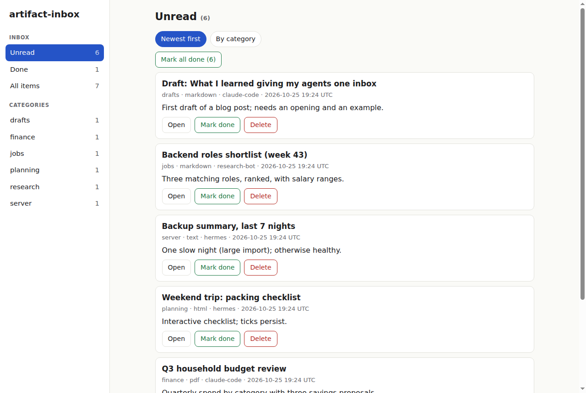
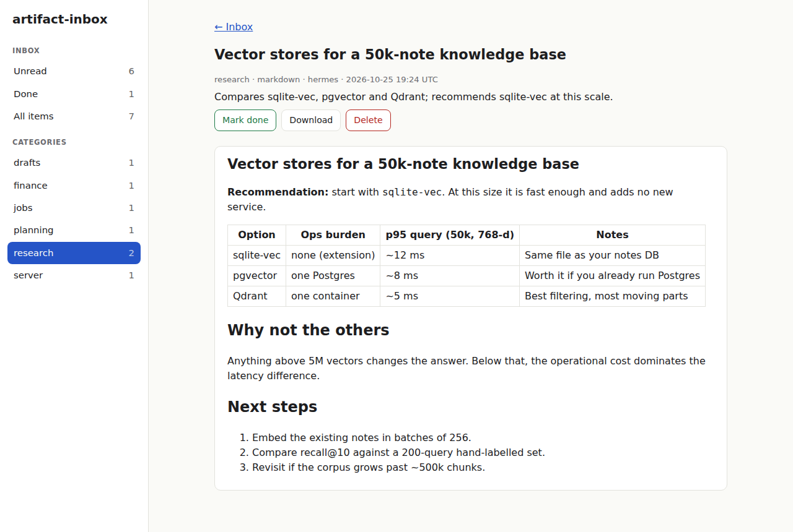
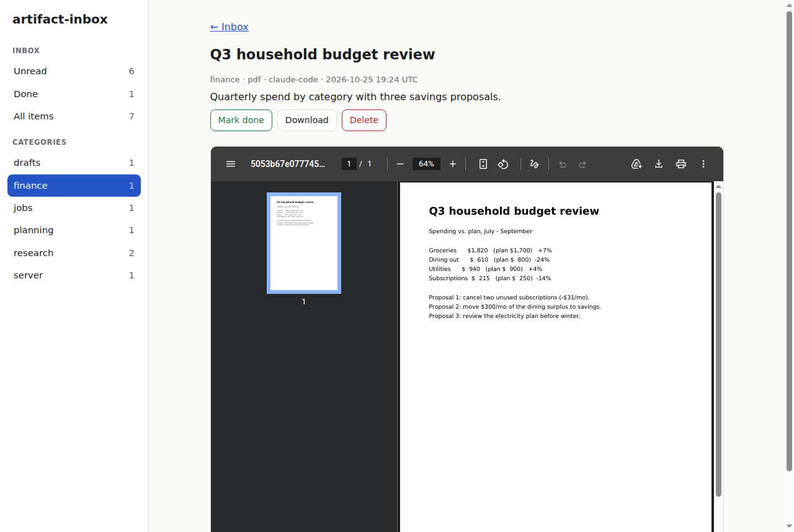
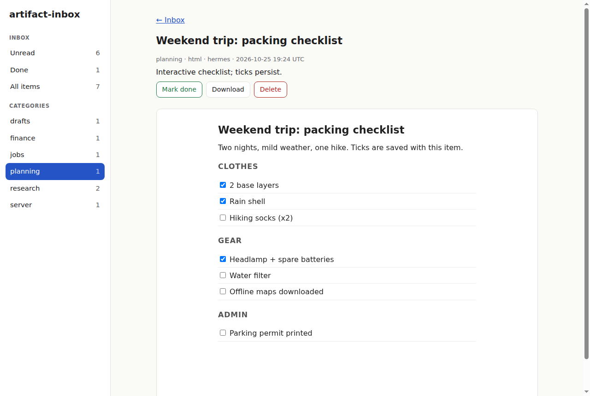
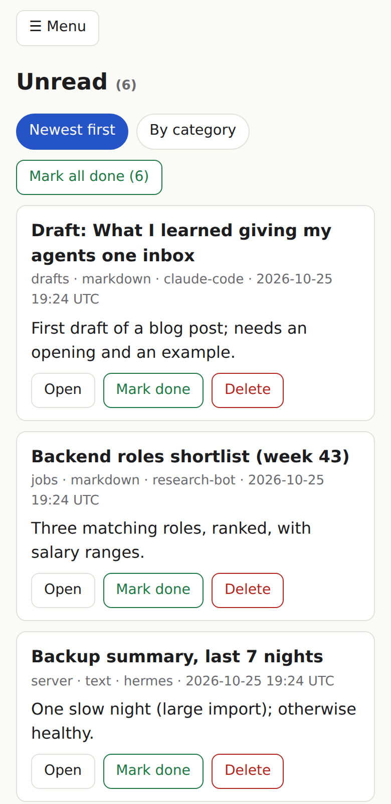

# artifact-inbox

A self-hosted **inbox for everything your AI agents produce**. Agents push finished documents (PDF, markdown,
HTML, text) over MCP or REST; you read, sort and mark them done in one clean web UI.



## Why

I run several agents: a chat bot, a coding agent, a research agent, scheduled jobs. Each one produces real work
(reports, comparisons, drafts, summaries), and each one leaves it somewhere different: a chat thread, a desktop
app, a file on a server. A 10-page report scrolling past in a chat bubble doesn't get read. A week later nobody
(me included) can find it.

What I wanted was a single place where *every* artifact from *every* agent lands, so there is one thing to check
instead of five, and a proper reading interface instead of whatever each bot's UI happens to offer: a real PDF
viewer, rendered markdown, categories, an unread/done state, and a layout that works on a phone. Agents write;
I read when I have time; nothing is lost in scrollback.

So: one small container, one bearer token, and a skill that teaches any agent when to push something and when
to just answer in chat.

## Features

- **Agent-friendly**: MCP (streamable HTTP) at `/mcp`, REST at `/api/push`, and `/install`, a page an agent can
  follow to configure itself (plus a ready-made skill, `/install/SKILL.md`).
- **Reads well**: PDFs in the browser's viewer, sanitised markdown, sandboxed interactive HTML (a pushed checklist
  keeps its ticks), plain text. Dark mode and phone layout.
- **Triage**: unread/done, categories with counts, "mark all done" per category, source agent and summary on every item.
- **Small**: Python, SQLite, one container, ~256 MB.

| Markdown | PDF | Interactive HTML | Phone |
|---|---|---|---|
|  |  |  |  |

## Quick start

```sh
cp .env.example .env            # set INBOX_API_TOKEN (openssl rand -hex 32), INBOX_BASE_URL, INBOX_UI_PASSWORD
mkdir -p data && sudo chown 1000:1000 data
docker compose up -d            # pulls ghcr.io/mrlo/artifact-inbox (amd64/arm64); UI on http://127.0.0.1:8000
```

To build from source instead: `docker compose up -d --build`. Pin a release with `image: ghcr.io/mrlo/artifact-inbox:0.1.0`.

Push something:

```sh
curl -sS -X POST http://127.0.0.1:8000/api/push \
  -H "Authorization: Bearer $INBOX_API_TOKEN" \
  -F file=@report.pdf -F title="Report title" -F category=research -F source_agent=me -F summary="One line."
```

Connect an agent over MCP (Claude Code example):

```sh
claude mcp add --transport http artifact-inbox http://127.0.0.1:8000/mcp --header "Authorization: Bearer $INBOX_API_TOKEN"
```

## Security: read this before exposing it

Two layers, both optional to combine:

- `/mcp` and `/api/*` always require the bearer token (`INBOX_API_TOKEN`).
- The web UI is protected by **built-in HTTP basic auth when `INBOX_UI_PASSWORD` is set** (user `INBOX_UI_USER`,
  default `admin`). If you leave it empty, the UI is open and you must put it behind your own auth (SSO proxy,
  VPN/Tailscale). The default compose file binds to `127.0.0.1` for that reason.

Basic auth has no lockout or rate limiting, so use a long password and serve it over HTTPS (or keep it private). See [docs/DEPLOYMENT.md](docs/DEPLOYMENT.md) for the model and a Traefik example
([examples/compose.traefik.yml](examples/compose.traefik.yml)).

What the app does enforce:

- Constant-time token compare; fails closed if `INBOX_API_TOKEN` is unset.
- PDFs recognised by `%PDF-` magic bytes, not file names; binary non-PDF content rejected (415); 50 MB cap (413).
- Files stored under random ids; user-supplied names never touch the disk.
- Markdown rendered with raw HTML disabled, then sanitised (nh3). HTML items run in
  `<iframe sandbox="allow-scripts">` with a CSP that blocks network access; `/raw/<id>` sends `CSP: sandbox`.
  All files carry `X-Content-Type-Options: nosniff`.
- `push_artifact(url=...)` fetches only public addresses (non-global IPs refused, redirects re-checked, size capped).
- UI POSTs reject cross-origin `Origin` headers.

Known limitations: single shared token (no per-agent tokens or users), DNS-rebinding race on URL fetch
(resolve-then-connect), UI lists only the newest 500 items, no rate limiting on failed token or password attempts.

## Configuration

| Variable | Purpose |
|---|---|
| `INBOX_API_TOKEN` | Bearer token for `/mcp` and `/api/*` (required) |
| `INBOX_UI_PASSWORD` | Enables basic auth on the web UI (empty = no UI auth; rely on your proxy) |
| `INBOX_UI_USER` | Basic-auth user (default `admin`) |
| `INBOX_BASE_URL` | Public URL, used in returned links and the `/install` page (default `http://localhost:8000`) |
| `INBOX_DATA_DIR` | Data directory inside the container (default `/data`) |

Data lives in `./data` (`inbox.db` and `files/`). Back it up. Rotate the token: new value in `.env`,
`docker compose up -d`, update each agent.

## Docs

- [docs/GUIDE.md](docs/GUIDE.md): user guide (UI, interfaces, rules, troubleshooting)
- [docs/DEPLOYMENT.md](docs/DEPLOYMENT.md): security model and reverse-proxy setups
- [docs/INSTALL.md](docs/INSTALL.md): agent-facing setup page served at `/install`
- [skill/SKILL.md](skill/SKILL.md): agent skill (`artifact-inbox`)

## Try it with demo data

```sh
INBOX_API_TOKEN=... python3 scripts/seed_demo.py http://127.0.0.1:8000
```

Adds seven fictional items (markdown, a PDF, an interactive HTML checklist, text). The screenshots above were taken this way.

## Development

```sh
python3 -m venv .venv && .venv/bin/pip install -r requirements.txt pytest && .venv/bin/python -m pytest -q tests
```

## License

[MIT](LICENSE)
